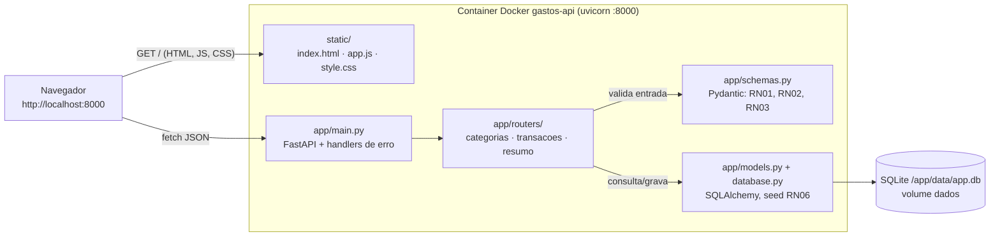
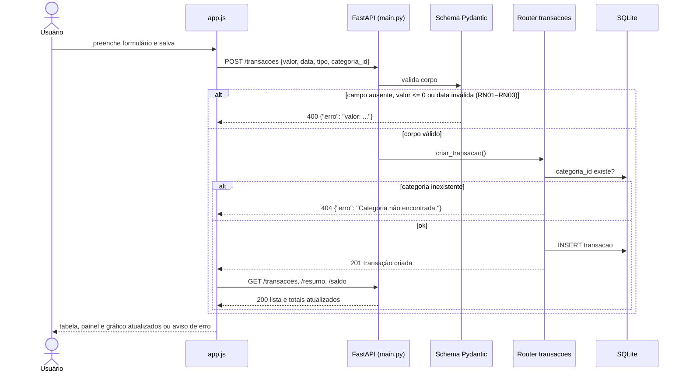

# Sistema de Controle de Gastos Pessoais

API REST local com interface web para registrar receitas e despesas, organizá-las em categorias
personalizadas, filtrar por período, consultar saldo e resumo financeiro e exportar relatório em CSV.

O sistema roda inteiramente na máquina do usuário e guarda tudo em um banco SQLite local:
**nenhuma informação financeira sai do computador**. Projeto acadêmico desenvolvido segundo o
documento `Especificação Técnica _ SDD.pdf` (Spec-Driven Development).

Repositório: https://github.com/LeoCeubs/sistema-controle-gastos-pessoais

## Stack

Python 3.12 · FastAPI · SQLAlchemy 2 · SQLite · Pydantic 2 · Pytest · Docker / Docker Compose ·
HTML, CSS e JavaScript puro

## Arquitetura

Monólito local em um único container. O mesmo processo FastAPI serve a API REST e os arquivos da
interface web, e grava num arquivo SQLite guardado em volume Docker. Não há serviço externo,
autenticação nem chamada de rede para fora da máquina.



| Camada | Arquivo | Responsabilidade |
|---|---|---|
| Interface | `static/` | Telas, formulários, filtros, gráfico; consome a API via `fetch` |
| Aplicação | `app/main.py` | Cria o app, registra routers, converte todo erro em `{"erro": ...}` |
| Rotas | `app/routers/` | Um arquivo por domínio; regras que dependem do banco (RN04, RN05) |
| Contratos | `app/schemas.py` | Formato de entrada/saída e validação de campo (RN01–RN03) |
| Persistência | `app/models.py`, `app/database.py` | Tabelas, sessão, criação do banco e categorias padrão |

### Fluxo de uma requisição

Exemplo: cadastro de despesa pela interface (RF01). Os outros endpoints seguem o mesmo caminho.



## Pré-requisitos

- [Docker Desktop](https://www.docker.com/products/docker-desktop/) com Docker Compose v2
- (alternativa sem Docker) Python 3.11 ou superior

## Como executar

### Com Docker (recomendado)

```bash
docker compose up --build
```

Pronto. A aplicação sobe em **http://localhost:8000**:

| Endereço | O que é |
|---|---|
| http://localhost:8000 | Interface web |
| http://localhost:8000/docs | Documentação interativa da API (Swagger) |
| http://localhost:8000/health | Status do serviço |

Parar: `docker compose down` — os dados **permanecem**, guardados no volume `dados`.
Para apagar o banco junto: `docker compose down -v`.

### Sem Docker

```bash
python -m venv .venv
.venv\Scripts\activate        # Windows
source .venv/bin/activate     # Linux / macOS

pip install -r requirements.txt
uvicorn app.main:app --reload
```

O banco é criado em `./data/app.db` na primeira execução, junto com as categorias padrão.

## Testes automatizados

Suíte Pytest + `TestClient` do FastAPI em `tests/test_api.py` (RNF05), cobrindo cenário normal e
casos de borda (RN02, RN04, saldo/resumo).

```bash
docker compose up -d --build           # sobe a API e cria o banco
docker compose exec api pytest -v      # roda a suíte dentro do container
```

Sem Docker, com a venv ativa: `pytest -v`.

> **Atenção:** os testes usam o mesmo banco da aplicação e dependem de as tabelas já existirem.
> Por isso o comando acima sobe a API antes. Em banco recém-criado, sem a API ter iniciado, os
> testes falham com `no such table: categorias` (detalhe em [`docs/adr.md`](docs/adr.md), ADR-10).

## Interface web

Abrindo `http://localhost:8000` o usuário tem, sem instalar nada além do Docker:

- **Painel de resumo** — receitas, despesas e saldo do período filtrado, mais o saldo total
  acumulado. Saldo negativo aparece em vermelho, mas não bloqueia nada (RN07).
- **Gráfico de despesas por categoria** — barras horizontais ordenadas por valor, respeitando o
  filtro ativo. Acima de seis categorias as menores viram "Outras". Cada barra traz nome, valor e
  percentual, então a leitura não depende da cor.
- **Tema claro e escuro** — a página acompanha automaticamente a preferência do sistema
  (`prefers-color-scheme`), sem botão nem configuração.
- **Aba Lançamentos** — formulário de cadastro/edição de receitas e despesas, tabela das
  movimentações, filtros por mês, ano e categoria, paginação e botão de exportar CSV.
- **Aba Categorias** — criar, renomear e excluir categorias personalizadas. A tentativa de
  excluir categoria em uso mostra a mensagem devolvida pela API (RN05).
- **Mensagens de erro** — qualquer falha da API (`{"erro": "..."}`) aparece em um aviso no topo
  da página, sem quebrar a navegação.

Atalho: `http://localhost:8000/#categorias` abre direto na aba de categorias.

## Endpoints

### Categorias

| Método | Rota | Descrição | Requisito |
|---|---|---|---|
| POST | `/categorias` | Cria categoria personalizada | RF02 |
| GET | `/categorias` | Lista as categorias | RF02 |
| PUT | `/categorias/{id}` | Atualiza o nome | RF02 |
| DELETE | `/categorias/{id}` | Remove (bloqueado se estiver em uso) | RF02, RN05 |

### Transações

| Método | Rota | Descrição | Requisito |
|---|---|---|---|
| POST | `/transacoes` | Cadastra receita ou despesa | RF01 |
| GET | `/transacoes` | Lista com filtros `mes`, `ano`, `categoria`, `limit`, `offset` | RF03, RF05 |
| GET | `/transacoes/{id}` | Consulta uma movimentação | RF03 |
| PUT | `/transacoes/{id}` | Atualiza uma movimentação | RF03 |
| DELETE | `/transacoes/{id}` | Exclui uma movimentação | RF04 |
| GET | `/transacoes/exportar` | Baixa `relatorio_gastos.csv` | RF09 |

### Resumos

| Método | Rota | Descrição | Requisito |
|---|---|---|---|
| GET | `/saldo` | Saldo atual (receitas − despesas) | RF06 |
| GET | `/resumo` | Totais do período (`mes`, `ano`) | RF07 |

Exemplo:

```bash
curl -X POST http://localhost:8000/transacoes \
  -H "Content-Type: application/json" \
  -d '{"valor":150.50,"data":"2026-09-10","tipo":"despesa","categoria_id":1,"descricao":"Compra no mercado"}'
```

Erros seguem sempre o mesmo formato, com status HTTP semântico:

```json
{ "erro": "Categoria em uso." }
```

## Estrutura do projeto

```
.
├── app/
│   ├── main.py              # aplicação FastAPI, handlers de erro, arquivos estáticos
│   ├── database.py          # conexão SQLite, sessão, criação de tabelas e seed
│   ├── models.py            # tabelas Categoria e Transacao (SQLAlchemy)
│   ├── schemas.py           # contratos de entrada/saída e validações (Pydantic)
│   └── routers/
│       ├── categorias.py    # RF02
│       ├── transacoes.py    # RF01, RF03, RF04, RF05, RF09
│       └── resumo.py        # RF06, RF07
├── static/                  # interface web (RF08)
│   ├── index.html           # estrutura da página
│   ├── style.css            # estilos
│   └── app.js               # consumo da API, filtros, paginação, exportação
├── tests/
│   └── test_api.py          # suíte Pytest (RNF05)
├── docs/
│   ├── adr.md               # registro consolidado de decisões de arquitetura
│   ├── evidencias.md        # saídas reais da validação manual dos endpoints
│   ├── entrega/             # textos das seções do relatório de entrega
│   └── ia/                  # configuração do agente de IA e registro de prompts
├── Dockerfile
├── docker-compose.yml
├── requirements.txt
└── CLAUDE.md                # regras de contexto para os agentes de IA
```

## Decisões de arquitetura (ADRs)

Resumo abaixo; contexto, alternativas e trade-offs de cada decisão em [`docs/adr.md`](docs/adr.md).

| ADR | Decisão | Principal trade-off aceito |
|---|---|---|
| 01 | Python + FastAPI | Validação e Swagger automáticos; menos controle fino que montar tudo à mão |
| 02 | SQLite + SQLAlchemy em volume Docker | Zero servidor de banco; escrita concorrente limitada (app monousuário) |
| 03 | Docker Compose como execução padrão | Ambiente idêntico para todos; exige Docker Desktop instalado |
| 04 | Frontend HTML/CSS/JS puro servido pela API | Sem build nem CORS; mais código manual de DOM |
| 05 | Erro único `{"erro": ...}`, 422 vira 400 | Contrato fiel à SDD; perde a lista detalhada de erros do FastAPI |
| 06 | CSV com módulo `csv` da stdlib | Sem pandas; formatação feita à mão |
| 07 | Validação de campo no schema, regra de banco no router | Duas camadas de validação para conhecer |
| 08 | Git flow `main`/`develop`/`feature/*` com PR e revisão obrigatória | Mais lento que push direto; nada entra sem par |
| 09 | Agente de IA governado por `CLAUDE.md` e fluxo SDD | Configuração inicial e prompts mais longos |
| 10 | Testes com `TestClient` sobre o banco da aplicação | Simples de escrever; testes não isolados (ver dívida registrada) |

## Evidências de execução

- Validação manual de todos os endpoints, 12 casos de borda, CSV e persistência:
  [`docs/evidencias.md`](docs/evidencias.md).
- Histórico dos prompts usados com o agente de IA: [`docs/ia/prompts.md`](docs/ia/prompts.md).
- Suíte automatizada: seção [Testes automatizados](#testes-automatizados).

## Uso de IA no desenvolvimento

O projeto usa **Claude Code** como agente de geração/auxílio de código, seguindo o fluxo SDD.
As regras permanentes do agente estão em [`CLAUDE.md`](CLAUDE.md); a configuração da ferramenta,
em [`docs/ia/agente.md`](docs/ia/agente.md); o histórico de prompts, em
[`docs/ia/prompts.md`](docs/ia/prompts.md).
